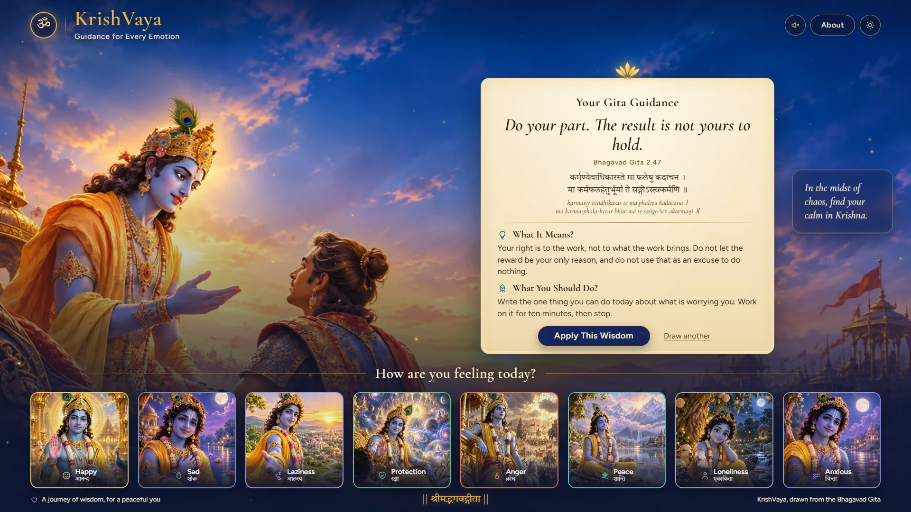
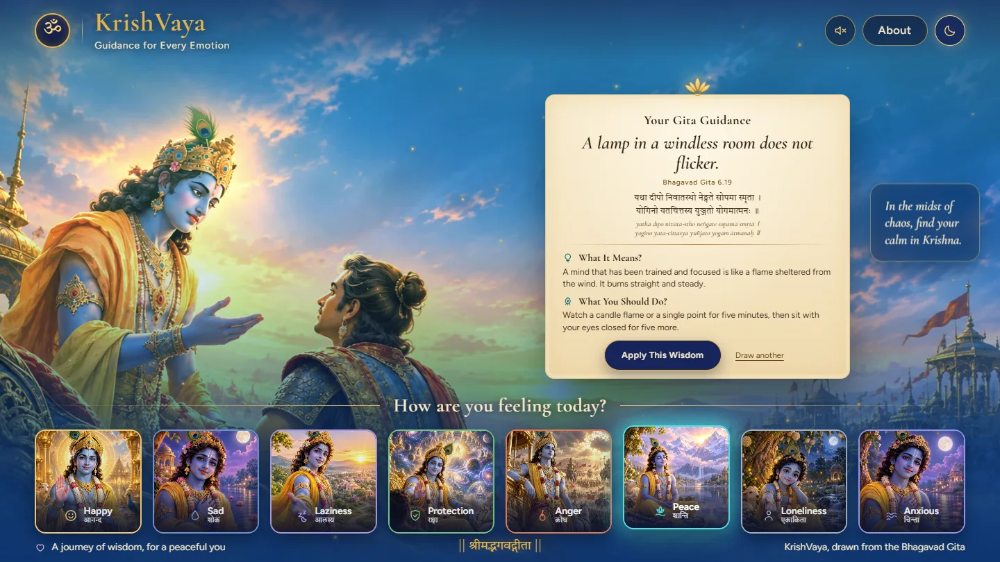
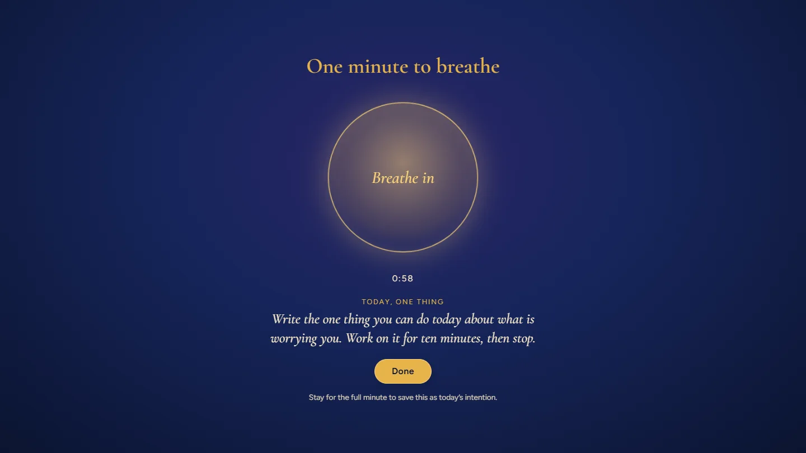
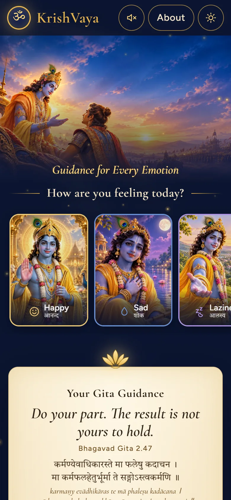
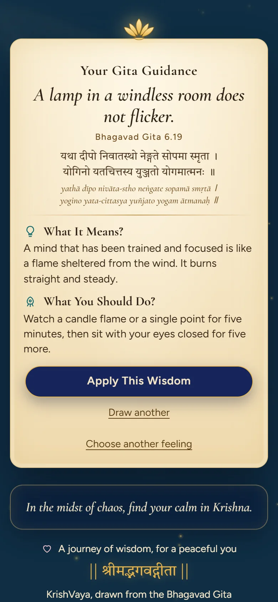

<div align="center">

# ॐ KrishVaya

### *Guidance for Every Emotion*

A quiet place to pause. Pick the feeling closest to yours and receive one verse from the Bhagavad Gita,
what it can mean in everyday words, and one small thing to do today.

[](https://prashanthkumarpk.github.io/KrishVaya/)
&nbsp;




</div>

---

## The idea

Most people don't open an app to read scripture. They open it because something feels off.
KrishVaya starts from that moment: **how are you feeling today?** One tap, and the page answers
with a verse, a plain-words meaning, and a ten-minute action. Nothing to sign up for, nothing to buy,
nothing to track.

It is meant to feel like dusk over Kurukshetra: warm gold light, slow movement, golden dust drifting
across the screen. Nothing flashes, bounces or snaps.

## Highlights

| | |
| --- | --- |
| 🪔 **Eight feelings** | Happy, Sad, Laziness, Protection, Anger, Peace, Loneliness, Anxious. Each has its own illustration, rim colour and set of verses. |
| 📜 **Parchment guidance** | The old scroll rolls up and a new one unrolls, then the verse fades in line by line. Sanskrit, transliteration, meaning, and one concrete action. |
| ✨ **Golden glitter** | A single `<canvas>` of drifting sparks in three depth layers. A burst rises from the card on every reveal; hovering a tile pulls nearby sparks softly toward it. |
| 🌅 **Mood tint** | The whole page shifts toward the feeling you picked (warm orange for Happy, deep blue for Sad, ember red for Anger, teal for Peace, and so on). |
| 🫁 **One minute to breathe** | "Apply This Wisdom" opens a calm overlay with a breathing circle (in for 4s, out for 6s). Finish the minute and the action is saved as today's intention. |
| 🔁 **Draw another** | A different verse for the same feeling, never the same one twice in a row. |
| 🌗 **Soft day theme** | One tap switches from dusk to a gentler daytime look. |
| 🎶 **Optional ambient sound** | Off by default, never autoplays, fades in and out over two seconds. |

<div align="center">

| Soft day theme | One minute to breathe |
| :---: | :---: |
|  |  |

</div>

## Designed for phones first

On mobile the one thing to do is right at the top: a compact header, a short hero, then the
feelings as a swipe row. Tap one and the page glides to your guidance; a link takes you back to
choose again.

<div align="center">

| Choose a feeling | Your guidance |
| :---: | :---: |
|  |  |

</div>

On desktop the whole app fits a single screen at any window size, from a short laptop to a large
monitor. The card reads the space it has and scales itself to fit.

---

## Quick start

```bash
git clone https://github.com/Prashanthkumarpk/KrishVaya.git
cd KrishVaya
npm install
npm run dev        # http://localhost:5173
```

| Command | What it does |
| --- | --- |
| `npm run dev` | Start the dev server with hot reload |
| `npm run build` | Production build into `dist/` |
| `npm run preview` | Serve the production build locally |

No environment variables, no API keys, no backend.

## Deploy to GitHub Pages (free)

The project is already set up for it. `vite.config.js` uses `base: './'`, so the build works under any
sub-path, and `.github/workflows/deploy.yml` builds and publishes on every push to `main`.

1. Push the repo to GitHub.
2. Open **Settings → Pages → Build and deployment** and set **Source** to **GitHub Actions**.
3. Push to `main` (or run the workflow from the **Actions** tab).
4. The site appears at `https://<your-username>.github.io/<repo-name>/`.

## Adding your own content

### Verses and guidance

Everything the app says lives in **one file: [`src/data/slips.js`](src/data/slips.js)**.

```js
{
  id: 'anxious-2-47',   // unique
  ref: '2.47',          // chapter.verse
  devanagari: '...',    // Sanskrit from the Gita; use \n between the two lines
  iast: '...',          // transliteration
  quote: 'short English line shown large on the card',
  meaning: '2 to 3 sentences in plain words',
  action: 'one concrete thing to do today (about 10 minutes)',
}
```

Add the slip to the array for its feeling inside `SLIPS`. The same file defines each feeling's label,
Sanskrit name, tile image, tint and rim colour (`FEELINGS`), the floating quote lines (`QUOTES`), and the
verse shown on first load (`DEFAULT_SLIP_ID`).

**Content rules**

- Sanskrit comes from the Gita. The quote, meaning and action are written fresh, never copied from a translation or commentary.
- Warm and direct. No preaching.
- Never claim medical or therapeutic benefit.

### Images and audio

Every asset is optional. If a file is missing, the app falls back to a gradient in that mood's colours and a simple glyph, never a broken-image icon.

| File | Size |
| --- | --- |
| `public/images/hero.webp` | 1920×1080, Krishna and Arjuna scene |
| `public/images/tiles/{happy,sad,lazy,protection,anger,peace,lonely,anxious}.webp` | 480×600 each |
| `public/images/om.svg` | Om emblem (falls back to a gold ॐ) |
| `public/audio/ambient.mp3` | Optional flute or ambient loop |

## Under the hood

```
src/
├── data/slips.js            all verses, feelings and quotes
├── components/
│   ├── Glitter.jsx          canvas particles: drift, burst, hover pull
│   ├── GuidanceCard.jsx     parchment card and its roll/unroll states
│   ├── Tiles.jsx            the eight feeling buttons
│   ├── BreathOverlay.jsx    60-second breathing session
│   ├── FloatingQuote.jsx    glass quote that rotates every 20s
│   ├── AboutModal.jsx       about and disclaimer
│   ├── Header.jsx, Icons.jsx, SoftImg.jsx
├── hooks.js                 reduced-motion and focus-trap hooks
├── useAmbient.js            optional audio with 2s fades
├── App.jsx, styles.css      layout, theming, animation
```

- **React 19 + Vite.** No UI library, no animation library. Plain CSS and one canvas.
- **Glitter** uses `requestAnimationFrame`, caps the device pixel ratio at 2, scales the particle count to the screen (about 90 on desktop, 40 on a phone), and pauses when the tab is hidden.
- **Layout** on desktop is driven by a CSS size container, so the card, header and tiles always fit one screen.
- **Storage:** the only thing saved is your theme choice and, if you finish a breathing session, today's intention, both in your own browser's `localStorage`.

### Design tokens

| Token | Colour | | Token | Colour |
| --- | --- | --- | --- | --- |
| midnight | `#0b1430` | | parchment | `#f6e7c8` |
| indigo | `#16255a` | | parchment-edge | `#e2c88f` |
| dusk-violet | `#3b2f7a` | | ink | `#2b1f14` |
| gold | `#e6b34a` | | peacock-teal | `#1b8a8f` |
| bright-gold | `#ffd777` | | lotus | `#f3c4cf` |

Fonts: **Cormorant Garamond** for headings and verses, **Figtree** for body text, **Tiro Devanagari Sanskrit** for Devanagari.

## Accessibility

- **Reduced motion:** the glitter drift stops (a few still specks remain), and parallax, floating and light-ray movement are removed. The scroll roll/unroll becomes a simple fade.
- **Keyboard and screen readers:** tiles are real `<button>` elements with `aria-pressed`, a visible lotus-pink focus ring and a 44px minimum touch target. The guidance card is `aria-live="polite"`. Dialogs trap focus, close on `Esc`, and make the page behind them inert.
- **Contrast:** ink on parchment is about 13:1; gold on midnight about 9:1, on indigo about 7:1.
- **Performance:** tile images are lazy-loaded webp with width and height set, so nothing shifts as they load.

## A note on what this is

KrishVaya is **spiritual reflection, not a replacement for professional help**. If you are struggling,
please talk to a doctor, a counsellor or someone you trust. If you are in danger, contact your local
emergency number.

---

<div align="center">

*A journey of wisdom, for a peaceful you.*

**|| श्रीमद्भगवद्गीता ||**

</div>
